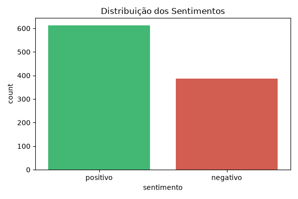
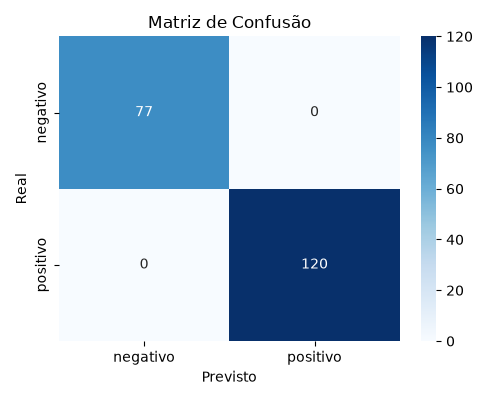

# Python Estudos

Meus estudos de Python, do básico até Machine Learning, feitos durante o curso
**Fundamentos de Linguagem Python - Do Básico a Aplicações de IA** (Data Science Academy).

O objetivo é chegar em agentes de IA, bots e automações para a [Dumont Web](https://github.com/TIAGODUMONT).

## Projetos

| Pasta / arquivo | O que é |
|---|---|
| [`projeto-01-site-flask`](projeto-01-site-flask) | Primeiro site com Flask |
| [`projeto-02-media-notas`](projeto-02-media-notas) | Cálculo de média de notas |
| [`projeto-03-banco-flask`](https://github.com/TIAGODUMONT/agencia-dumont-flask) | Site com Flask (repositório próprio) |
| [`projeto-04-analise-ecommerce`](https://github.com/TIAGODUMONT/analise-ecommerce-python) | Análise de dados de e-commerce em Jupyter (repositório próprio) |
| [`equacao.py`](equacao.py) | **Análise de sentimentos de reviews** com Machine Learning |

## Destaque: análise de sentimentos de reviews

Uma empresa de e-commerce lê os reviews dos clientes à mão, o que é lento, caro e não escala.
Este projeto cria um modelo que classifica cada review como **positivo** ou **negativo** automaticamente.

**Etapas** (em [`equacao.py`](equacao.py)):

1. Carregamento dos dados (`dados/reviews.csv`)
2. Análise exploratória: valores ausentes e distribuição dos sentimentos
3. Limpeza do texto: minúsculas, sem acentos, sem pontuação
4. Engenharia de atributos e divisão em treino (80%) e teste (20%)
5. Pipeline: `TfidfVectorizer` → `StandardScaler` → `LogisticRegression`
6. Otimização com `GridSearchCV`
7. Avaliação: Acurácia, Precisão, Recall, F1-Score e matriz de confusão
8. Modelo salvo com `joblib` (`modelo_sentimento.pkl`)
9. Simulação de deploy: função que classifica reviews novos




> **Atenção:** os dados são **fictícios**, gerados por [`gerar_reviews.py`](gerar_reviews.py).
> Como são simples, o modelo acerta 100%. Com reviews reais, o esperado é bem menos.

## Como rodar

```bash
python -m venv .venv
.venv\Scripts\activate        # Windows
pip install -r requirements.txt

python gerar_reviews.py       # gera dados/reviews.csv
python equacao.py             # treina, avalia e salva o modelo
```

## Tecnologias

Python 3.13 · pandas · NumPy · scikit-learn · Matplotlib · Seaborn · joblib · Flask
